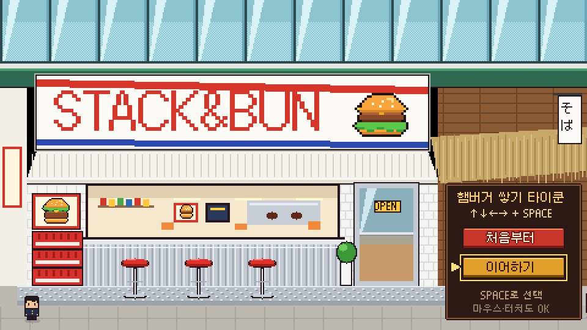
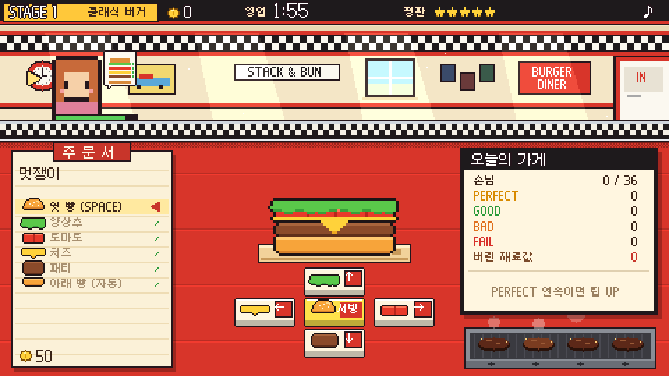

# STACK & BUN — 햄버거 쌓기 타이쿤

방향키로 버거를 쌓는 레트로 다이너 타이쿤

▶ **[플레이하기](https://yeseullee-lab.github.io/stacknbun/)**

## 조작
- `↑` `↓` `←` `→` : 재료 쌓기 (스테이지마다 재료 배치가 바뀜)
- `Space` : 윗 빵을 덮어 서빙 / 메뉴 선택
- 모바일: 화면의 키 가이드를 누르거나 스와이프

폰트: [Galmuri](https://github.com/quiple/galmuri) (SIL Open Font License 1.1)
